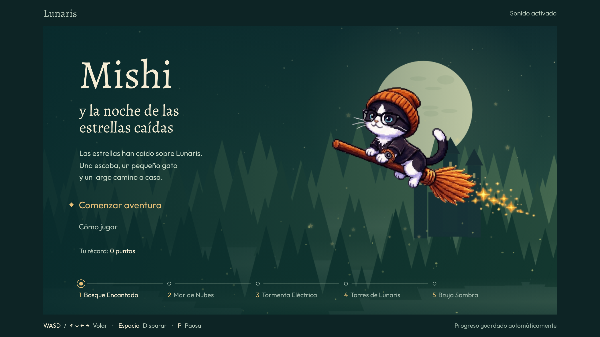
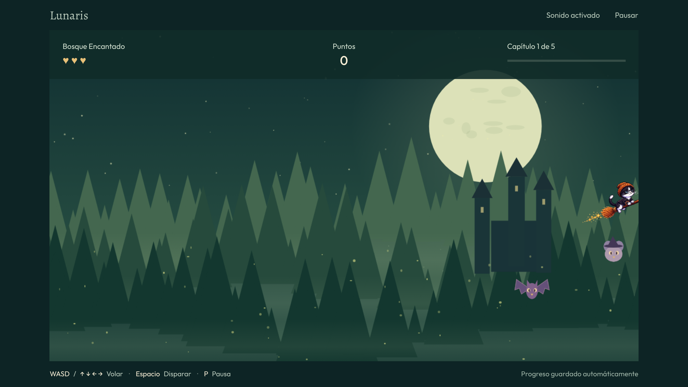
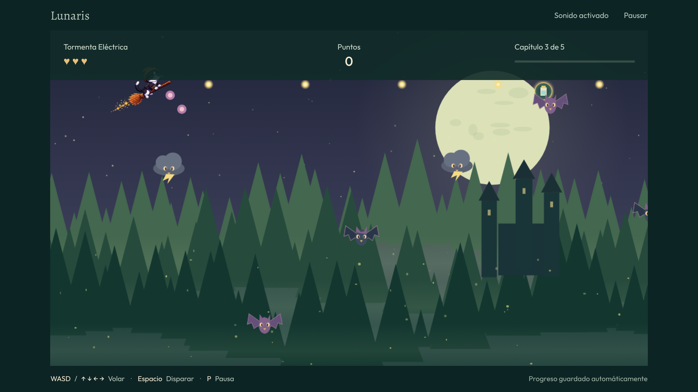
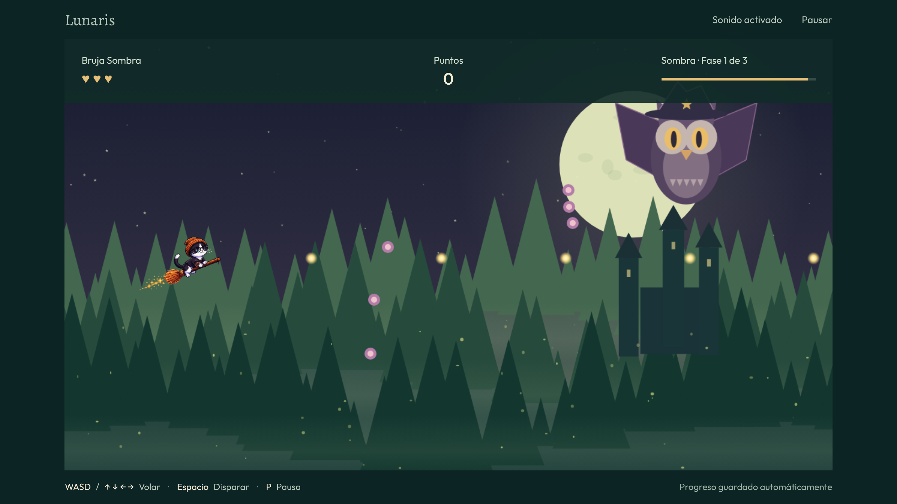
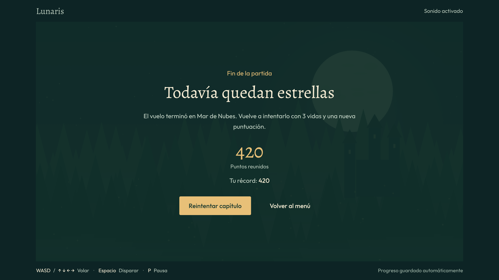
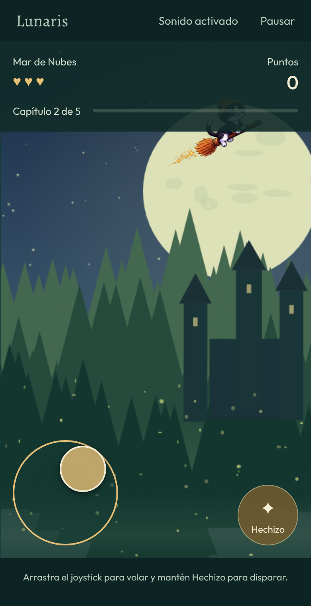

# PROYECTO FINAL PRIMER BIMESTRE : DESARROLLO DE VIDEOJUEGOS CON PHASER.JS

# Integrantes:

- Isabel Farinango
- Anndy Rengifo
- Stiven Viscaino


# Mishi y la Noche de las Estrellas Caídas

Videojuego **Arcade Shooter** 2D hecho con JavaScript y Phaser 3.90.0. Mishi, una gatita bruja aprendiz, vuela en su escoba por cinco escenarios para recoger las chispas de la Linterna Estelar de Lunaris y enfrentarse a la Bruja Sombra.

- **Jugar en línea (computadora y celular):** https://sailost.github.io/Mishi-Lunaris/

## Historia

En el Castillo de Lunaris, la Gran Linterna Estelar mantiene encendidas las estrellas del cielo. Durante el examen anual, la Bruja Sombra (una lechuza gigante) roba la Linterna y la rompe en cientos de chispas que caen sobre el bosque. Las criaturas de la noche se corrompen y los demás gatos brujos quedan atrapados en el castillo. Mishi, la más pequeña y a la que nadie toma en serio, es la única que se atreve a volar esa noche.

| Elemento del juego | Dentro de la historia |
| ------------------ | --------------------- |
| Puntaje | Chispas de estrella recogidas |
| Disparo | Hechizos de Mishi (bolas de luz) |
| Enemigos | Murciélagos, cuervos, nubes de tormenta y ratones brujos |
| Vidas | Las siete vidas del gato (se empieza con 3) |
| Poderes | Leche mágica, pez dorado y ovillo estelar |
| Derrota | Mishi pierde todas sus vidas y la noche queda a oscuras |
| Victoria | Vence al jefe y la Linterna vuelve a brillar |
| Nivel guardado | La escoba recuerda hasta dónde llegaste |

## Cómo ejecutarlo

**Opción 1: abrir el archivo.** Abre `index.html` en el navegador. El juego incluye todos sus recursos (Phaser, fuentes e imágenes) y no necesita instalar nada ni conexión a internet.

**Opción 2: servidor local** (requiere Node.js):

```bash
npm start
```

Después abre `http://localhost:4173`.

**Opción 3: en el celular.** Abre el enlace de "Jugar en línea" en el navegador del teléfono. El proyecto está publicado con GitHub Pages.

## Controles

| Acción | Computadora | Celular y tablet |
| ------ | ----------- | ---------------- |
| Volar | WASD o flechas | Joystick virtual: arrastra la bolita en cualquier dirección |
| Disparar | Mantener Espacio o J | Mantener el botón Hechizo |
| Pausar | P, Escape o botón Pausa | Botón Pausa |
| Sonido | Botón Sonido | Botón Sonido |

En el celular se puede mover y disparar al mismo tiempo. El joystick es analógico: mientras más lejos arrastras la bolita, más rápido vuela Mishi. En computadora el mouse sirve para los menús y botones. El menú "Cómo jugar" también explica estos controles dentro del juego.

## Reglas

- Mishi empieza con **3 vidas** y puede acumular hasta 7.
- Cada chispa recogida suma 10 puntos. Cada 300 puntos se recupera una vida.
- Los enemigos, proyectiles y rayos quitan una vida. Después de un golpe hay 1,5 segundos de invulnerabilidad.
- Si escapan 3 criaturas, se pierde una vida.
- Poderes (duran 8,5 segundos): **leche mágica** = escudo, **pez dorado** = disparo triple, **ovillo estelar** = atrae las chispas.
- Superar las cuatro primeras oleadas desbloquea el combate final. La Bruja Sombra tiene tres fases y en cada una dispara más rápido.

### Qué pasa al perder

Al quedarse sin vidas aparece la pantalla **"Todavía quedan estrellas"** con los puntos de la partida y el récord. Desde ahí se puede **reintentar el capítulo** (con 3 vidas y puntuación nueva) o **volver al menú**. El récord y el capítulo alcanzado no se pierden.

### Condición de victoria

Se gana al derrotar a la Bruja Sombra: aparece la pantalla "Lunaris vuelve a brillar" y se puede jugar de nuevo.

## Niveles

1. **El Bosque Encantado:** enemigos fáciles, sirve de tutorial.
2. **Mar de Nubes:** más velocidad y murciélagos en zigzag.
3. **Tormenta Eléctrica:** nubes de tormenta y rayos que hay que esquivar (los rayos siguen en los niveles 4 y 5).
4. **Las Torres de Lunaris:** enemigos en formación, en filas ordenadas, y más velocidad.
5. **La Bruja Sombra:** jefe final con tres fases.

## Requisitos de la guía

| Requisito | Dónde está |
| --------- | ---------- |
| Escenas, loader, menú, pausa, Game Over y reinicio | `src/scenes/` (Boot, Menu, Play, End) y `src/ui/UI.js` |
| Movimiento, colisiones, puntaje, HUD, victoria y derrota | `src/objects/`, `src/scenes/PlayScene.js`, `src/ui/UI.js` |
| Arcade Physics, overlaps y colisiones | `Player.js`, `Enemy.js`, `PlayScene.js` |
| Audio: música, efectos y mute | `src/audio/AudioManager.js` (5 efectos y música generada con Web Audio) |
| Persistencia con `localStorage` | `src/managers/StorageManager.js` |
| Responsive y controles táctiles | `style.css` y `src/managers/ViewportManager.js` |
| Accesibilidad: contraste, instrucciones, controles y mute | Pantalla "Cómo jugar", etiquetas `aria` y esta guía |
| Bonus: jefe final con fases | `PlayScene.js` (`createBoss`) |

## Organización

```text
index.html                Página principal
style.css                 Interfaz y diseño adaptable
src/
  main.js                 Configuración e inicio
  scenes/                 Carga, menú, partida y resultados
  objects/                Personaje y enemigos
  managers/               Guardado y ajuste de pantalla
  physics/                Reglas y parámetros de niveles
  ui/                     Menús, HUD y controles
  audio/                  Música y efectos con Web Audio
  assets/                 Imagen del personaje, gráficos y fuentes
vendor/                   Phaser y su licencia
tests/                    Pruebas de lógica
tools/server.cjs          Servidor de desarrollo
capturas/                 Capturas del juego
```

Arcade Physics controla el movimiento y las colisiones. Los proyectiles y las estrellas se reutilizan para limitar la creación de objetos. Cada escena representa un estado del juego. Los scripts comparten el espacio de nombres `Mishi` y se cargan en el orden indicado en `index.html`.

## Guardado

`localStorage` conserva el **récord**, el **capítulo desbloqueado** y la **configuración de sonido** con la clave `mishi-lunaris-v1`. "Continuar" empieza en el capítulo guardado con 3 vidas y una puntuación nueva. El progreso pertenece a cada navegador y dirección web. Si el almacenamiento está bloqueado, la partida funciona con datos en memoria.

## Rendimiento y pausa

El objetivo de ejecución es 60 FPS, con un mínimo de 45. La partida se pausa sola si cambias de pestaña o de aplicación. El sonido comienza después de la primera interacción, como exigen los navegadores.

## Pruebas

```bash
npm test
```

Cubren persistencia, movimiento, daño, poderes, progresión, jefe y ajuste de pantalla. Las pruebas de lógica no miden FPS ni reemplazan una prueba en el dispositivo real.

## Capturas

| Menú principal | Nivel 1 |
| -------------- | ------- |
|  |  |

| Nivel 3 | Jefe final |
| ------- | ---------- |
|  |  |

| Derrota | Celular con joystick |
| ------- | -------------------- | 
|  |  |

